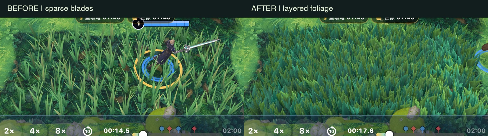

# 密集ブッシュ（2026-10-14）

既存の `MapDefinition.brushes` の矩形・中心・高さを使用。隠蔽判定は変更せず、
`StageLayout.brushFields` が各区画の近景/遠景メッシュをロード中に準備する。

- 近景：1株につき曲面カード3枚、12三角形。細葉・幅広葉・短葉を描いた4種のアトラスを混在。
- 遠景：同じ株の位置に平面カード2枚、4三角形。カメラから区画の最近点まで34mで切替、29mで復帰。
- テクスチャ：`StageBrushAtlas.png`、1024×512 RGBA、全草むらで共有。非圧縮RGBA8＋mip換算で約2.67MiB。
- 描画：区画ごとに材質1個の結合メッシュ。目安は表示区画1個あたり1ドロー/パス。
  インスタンシングではなく既存の区画単位結合を使用。影描画は無効。
  RealityKit内部パスや味方の透過時の追加コストを含む実測値ではない。
- 根元は固定、先端へ二乗の風ウェイト。既存のワールド座標による位相差、一定方向の穏やかな風を使用。
- 透過エッジはアルファのディザ＋透過光を模した発光。物理的な半透明散乱ではない。
  内部を完全な黒にせず、味方が入った区画の既存0.38不透明度フェードを維持。
- LODは0.2秒ごとに距離判定し、事前生成したメッシュを交換。ゲーム判定・視界判定に影響しない。

ダウンロード：[近景OBJ](brush_near.obj) / [遠景OBJ](brush_far.obj) / [材質](brush.mtl) / [RGBAテクスチャ](StageBrushAtlas.png)

## 再生成・確認

```
uv run --with pillow python VELSTRIA/tools/stage/brush_atlas.py
bash VELSTRIA/tools/stage/build_shaders.sh
cd VELSTRIA && xcodegen generate
```

`StageTests` は従来の9万三角形上限、矩形の範囲、シェーダー同期に加え、LODの削減率と根元固定ウェイトを確認。
`testBrushLODAndExport` はアプリのDocuments/BrushReviewへ実メッシュのOBJと集計を書き出す。
`brush_near.obj` / `brush_far.obj` は紅焔の番人の下（矩形index 6）のサンプル。
座標はメートル、+Yが上、原点は区画中心。配置時は既存の中心・スケールをそのまま使う。
OBJは風ウェイトを保持しないため、他エンジンではローカル高さから二乗ウェイトを復元する。
材質は両面表示・アルファクリップを有効にする。

DEBUG起動引数 `-brushLegacy` で旧版の生成関数を使い、同一カメラで比較できる。
比較画像は実ゲームのシミュレータ画面。実機FPSや参照ゲームと同等の品質を保証するものではない。

## 実メッシュの集計（標準マップ / medium）

| 対象 | 近景 | 遠景 |
| --- | ---: | ---: |
| 全44区画の合計三角形数 | 36,192 | 12,064 |
| 添付OBJの1区画（8.5×4.3m） | 1,440 | 480 |
| 全区画表示時の基本ドロー目安 | 44 | 44 |

実際は距離LODが混在し、画面外はエンジンがカリングする。両LODをメモリに保持する。

## 検証環境と結果

iPhone Airシミュレータ / iOS 26.3.1 / Debug。MetalはiOS・シミュレータ・macOS向けコンパイル成功。
StageTestsは9テスト中8通過。草むらの矩形・近遠LOD・素材・シェーダー・全画質の三角形予算は通過。
変更対象外の岩境界テストはlow/medium/highの3アサーションで失敗：
`cliff_rock_a` が許容0.4mに対し約0.4156mはみ出す。上限は変更していない。



撮影位置：地図座標(58.25, 19.35)、zoom 0.85、medium。
観戦の撮影時刻は前後で異なるためユニット位置は一致しない。草むらの配置・縮尺・カメラは共通。

通常速度のDebug観戦の動作確認で、`Kit_H027.flurryHit → CombatSystem → ItemEffects.onDamageDealt`
内のスレッドスタック超過が発生。草むらの描画とは別の戦闘処理で、今回は修正していない。

通常対戦では65秒の描画確認が完了し、記録対象の戦闘中アセット生成は0件。
[Debug動作確認ログ](smoke-debug.json)。自動画質はmedium開始からscale75まで低下。
これはRelease性能比較ではなく動作確認であり、実機FPSの改善は未検証。
