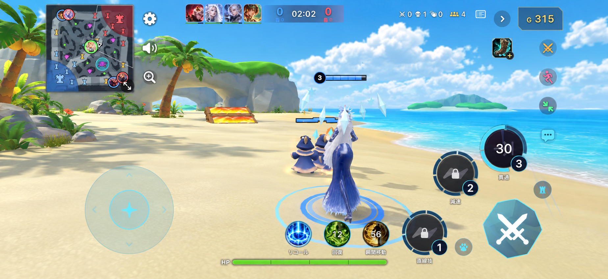
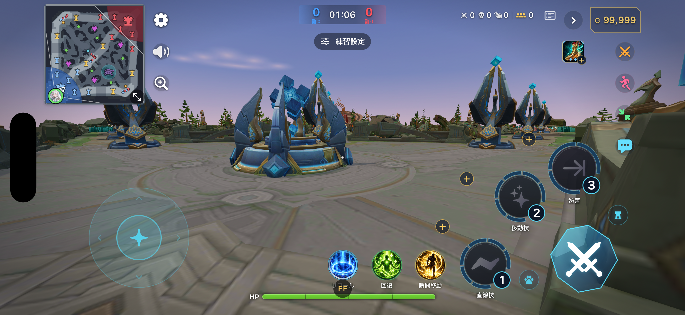
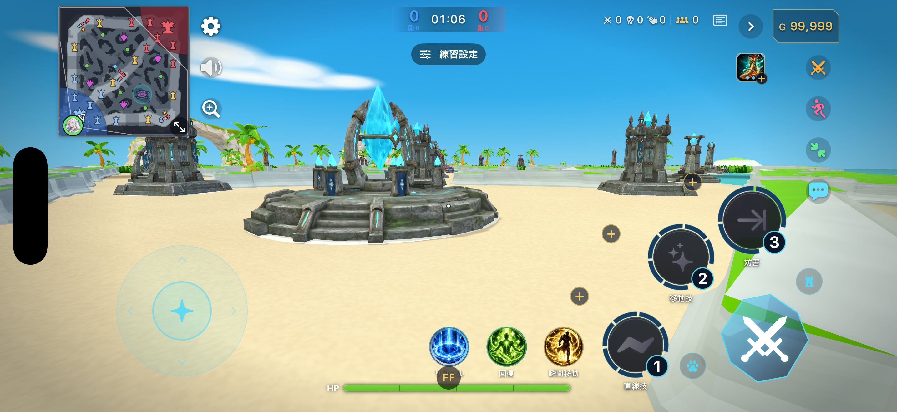
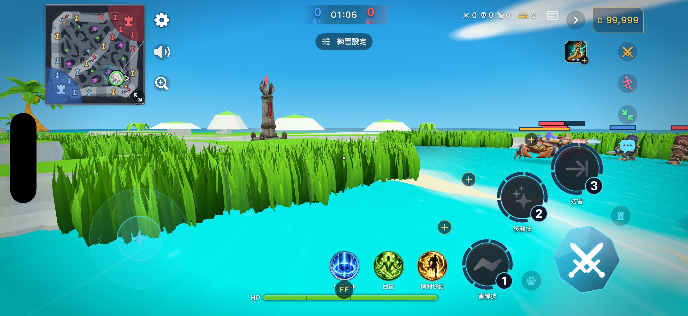

# Seaside 視界レビュー — 2026-10-28

Seaside を第2ステージとして追加し、既存／新規プロフィールの初期選択にした。
設定 → グラフィックで Canyon を選べる。キャラ・ミニオンは既存のまま。
レーン、衝突、草むら、構造物の位置、戦闘ルールは Canyon と共有し、記録済みの旧リプレイは Canyon を使う。

## 実描画と参考画像

ユーザー参考画像（手前は味方と味方ミニオン）:

変更前の Canyon、拠点からの一人称:

Seaside、同じキャラ・拠点・画質:

追加確認の海岸沿い（撮影専用の位置指定、通常の開始地点は変更しない）:

| 観点 | 今回の変更と残る差 |
| --- | --- |
| 空・森林の奥行き | 青空、白い雲、ヤシ、遠景の小島、草を冠した海食アーチを追加。参考より雲は柔らかく平たく、植生の密度は低い。 |
| 石畳・地面の凹凸 | 広い砂浜と細かな砂の模様へ変更。岩壁は斜面と面ごとの陰影を付けた。ゲーム判定に沿う壁の形は参考の自然な崖より規則的。 |
| 明暗・色 | 暖かい砂、青緑の浅瀬、白い岩に変更。初回の白飛びを材質と照明で抑えた。草と浅瀬の彩度は参考より高い。 |
| 戦闘対象の見やすさ | 壁を低くし、見通しを確保。既存のミニオンと敵のHPバーを海岸で確認。草むらの遮蔽表示・判定は維持。 |
| HUDの占有 | HUDは変更なし。左上マップと右側スキル群の占有は従来どおりで、参考との差は残る。 |

初回スクショを受けて、砂の白飛び、壁の高さ・面の陰影、アーチの大きさ、海岸線を調整した。
その後、専用画像から生成したモデルを導入し、アーチの開口とヤシの葉・ココナッツを実描画で確認した。
残る差は今後、雲の立体感と草・浅瀬の彩度、自然な崖の形を優先して調整する。主観的な比較であり、客観スコアではない。

## 素材と予算

内蔵 ImageGen で専用リファレンスを先に作成し、Meshy で海食アーチ、Tripo でヤシを生成。
アーチは同じ画像で再テクスチャし、Blenderで減面・材質焼き付けした。
アーチ 2,399 / ヤシ 2,400 三角形、共通アトラス1024²。既存の予算上限は変更していない。
[画像・プロンプト・生成履歴](../../../tools/stage/references/seaside/README.md) /
[全文プロンプト](../../../tools/stage/references/seaside/prompts.md) /
[焼き付け記録](../../../tools/stage/references/seaside/bake-report.json)。

選択したステージだけを StagePrep で準備し、材質と12m区画で結合する。
必須の壁・草むらを先に確保し、装飾は既存予算内に収める。波と葉の揺れは共有シェーダーで処理する。

## 検証条件

- iPhone 17 Pro Max シミュレータ / iOS 26.3、UUID `05815393-2FEB-4211-88EB-2F551468C34B`。
- Debug アプリ、H003、practice、高画質、`-stageFull -perfRun 65 -perfQuality high -visualReview`。
- 明示したアプリパスと出力先を `tools/vision_review.sh` に渡した。海岸は追加で `seaside coast`。
- 全撮影で notes の `quality at live/end: full`、フレーム時間による自動低下の無効化を確認。
  `ledger.live` は空。シミュレータの描画時間は実機FPSの改善の根拠にしない。
- Core関連・リプレイ決定論29件、アプリのStage/Settings/Online関連47件が成功。
  生成モデル導入後、Seasideの全画質予算・草むら整合・シェーダー3件を再確認して成功。最終Debugビルド成功。

[変更前の計測](before-perf.json) / [モデル導入後の計測](after-perf.json) / [海岸の計測](coast-perf.json)。
